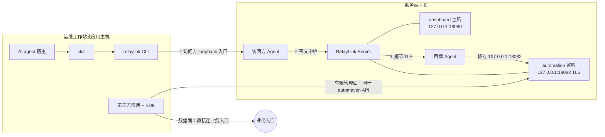
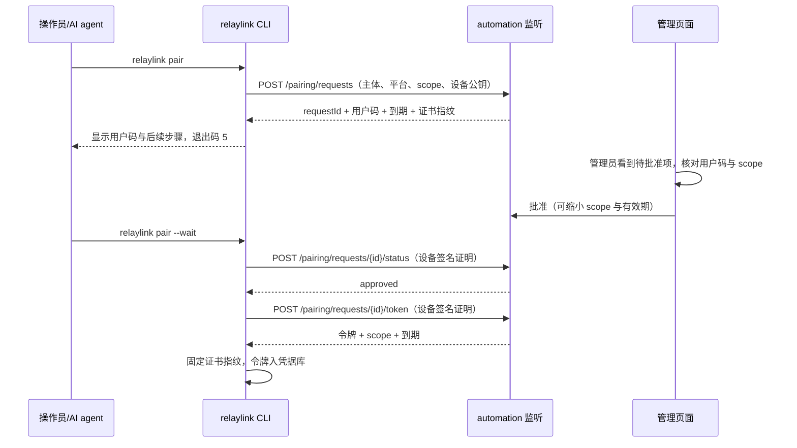
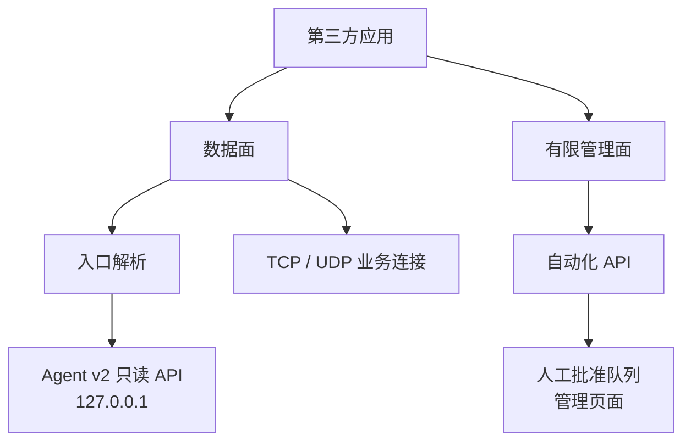

# AI 自动化与第三方 SDK 技术设计

文档 ID：DES-010\
状态：Draft\
版本：v0.2.2\
更新日期：2026-11-23\
调研日期：2026-11-05\
配套：[需求 REQ-001P](../requirements/2026-11-05-ai-automation-and-sdk.md)、[ADR-0035](../adr/0035-ai-automation-over-peer-channel.md)、[ADR-0036](../adr/0036-third-party-sdk-over-entries.md)

本文原为拟议设计；首期实现已按本设计落地，实现的进度与证据见[验证记录](../testing/ai-automation-verification.md)，未完成项在那里如实列出。文中端点、字段、错误码与退出码仍是实现约束，验收以需求的 A108–A119 为准——**已实现不等于已验收**。

实现过程中对设计做了三处收敛，均已写回正文：

1. **C 类的 `channel.security` 只覆盖端到端加密开关**。审计模式与授权形态在既有编辑器中不可修改，需删除通道重建；放开需单独设计并另立 ADR。
2. **SDK 管理面首期只承诺 C#/.NET**，且该管理面本身尚未接入 `RelayLink.Sdk`（数据面已实现）。其余五种语言受「仅标准库/JDK/内置模块」约束，读不了系统凭据库、需自行实现设备签名。
3. **证明必须携带 `instanceId`**，取值来自 `/info` 返回的持久化 `automationInstanceId`。最初设计只在配对证明里提它，令牌证明漏了，导致服务端无法把证明绑定到具体实例。

另有一处实现层面的发现值得记下：Kestrel 在 Windows 上无法直接用 `X509Certificate2.CreateFromPemFile` 返回的证书完成 TLS 握手（临时密钥标记），必须导出 PFX 再导入。这属于实现细节，不影响设计取舍，但会绊住第一次接线。

## 1. 调研结论

需要解决的问题不是“再加一个 API”，而是三件互相牵连的事：谁在调用、凭据怎么到调用方、以及这条调用链路必须和浏览器管理页一样处在加密与审计之内。

现状约束有四条，直接决定设计空间：

1. 管理 API 的鉴权对象是浏览器。会话是进程内字典（`AdminSessionService`），令牌是 `HttpOnly` + `SameSite=Strict` Cookie，写请求要 `X-RelayLink-CSRF`。把 Cookie 交给自动化进程，等于把管理员口令的有效期复制到磁盘上，且无法把“某个脚本”和“某次管理员登录”分开撤销。
2. 管理监听刻意维持明文 HTTP。`dashboard` 不提供 TLS，远程管理员被要求在 Server 本机跑 Agent，经授权互访的内层 TLS 打开管理页。为自动化单独开一个加密的公网端口，等于推翻这条既有取舍。
3. 唯一已被验证的“外部进程 → 服务端 loopback”加密路径是授权互访：访问方 Agent 在本机 `127.0.0.1` 提供入口，经服务端中转、目标 Agent 拨号到目标（目标可以是 Server 自己的 loopback）。它已经有客户端身份、每通道访问密钥、内层 TLS 与访问证明。
4. Agent 本机 API 的只读端点（`/api/v1/*`、`/api/v2/status|channels|mappings`）只有 GET，且不含任何服务端配置；它只能是“读取本机入口地址”的来源，不能承担管理面。同一 Kestrel 上另有 `/api/v2/admin/servers*` 写路由，但那只改本机 Agent 的 `servers[]` 连接项（见 ADR-0022、ADR-0023、ADR-0034），与 RelayLink 服务端配置无关，本设计不复用也不扩展它。

因此本设计不复用浏览器会话，也不新增公网端口，而是新增一个只绑 loopback 的自动化监听，独立设备身份与短时令牌，并把“到得了”和“认得清”两件事分开：能不能到达由既有授权互访通道负责，是谁在调用由设备密钥与令牌负责。

| 备选 | 判断 |
|---|---|
| 让 CLI 直接用管理员账号口令登录现有管理 API | 拒绝。自动化进程持有管理员口令，等于把人的凭证长期落到机器上；无法按客户端撤销；与“必须在控制台授权”冲突 |
| 给管理页加 API Key 静态头 | 拒绝。静态密钥不绑定设备，复制即用，无法区分审批对象，且违背一次性人工批准的目标 |
| 复用 Agent 本机 API 扩展为可写 | 拒绝。本机 API 的信任模型是“同机单用户”，把服务端配置写进去会让服务端配置受本机页面约束，且 ADR-0034 已明确本机无口令 |
| 自动化监听直接绑公网 + 强制 TLS | 拒绝。用户明确要求只走端到端加密通道，公网入口扩大攻击面且与既有部署模型不一致 |
| 新增一次性配对 + 设备绑定令牌（本文选择） | 采用。人工可核对用户码，令牌不可复制使用，撤销粒度到设备 |
| SDK 自建隧道/复用 NTP1 协议 | 拒绝。见 [ADR-0036](../adr/0036-third-party-sdk-over-entries.md)；协议不对外开放，SDK 只面向入口 |

## 2. 总体架构



三个参与方和三条独立性质：

- **可达性**：自动化监听只绑 `127.0.0.1`，只能由服务端主机上的 Agent 拨号到达。外部想访问，必须经过 `authorizedClientsOnly=true` 且 `endToEndEncryptionEnabled=true` 的授权互访通道。这条链路的两段内层 TLS 在两端 Agent 之间，服务端只中继密文。
- **身份**：CLI 用自己的设备密钥对证明身份；令牌绑定该公钥，复制到另一台机器无效。
- **授权**：设备拿到令牌之前，必须有一次管理员在管理页面的人工批准；令牌的 scope 只能从申请中缩小。

自动化监听自身再叠一层 TLS，用途不是链路加密（链路已由内层 TLS 保证），而是让 CLI 能确认“我连到的确实是这台服务端的自动化端点”，防止同一台主机上的任意本地进程在 loopback 上冒充或劫持。这层 TLS 与内层 TLS 的信任来源不同，设计上不合并。

**本方案不修改中继线协议。** 没有任何 `FrameType`、快照字段或版本号变化，自动化流量就是授权互访通道里的原始 TCP 字节。这是 A119 兼容性验收成立的前提，也是本设计最重要的取舍：宁可多一层 TLS，也不动协议。

SDK 数据面不经过自动化监听，也不经过 CLI：它直接连业务入口，因此只需要入口地址与一个 socket。SDK 有限管理面才与 CLI 一样受配对与批准约束。

### 2.1 “只经端到端加密通道”的精确含义

需求写“仅允许通过端到端加密的通道”。这句话必须按字面拆开交代，否则容易读成一条无法证伪的承诺。完整链路有四跳，其中两跳是主机内 loopback：

| 跳 | 位置 | 是否加密 | 由谁保护 |
|---|---|---|---|
| 1 | CLI → 访问方 Agent 的本机入口（`127.0.0.1`） | 明文 TCP | 仅靠 loopback 边界 + 该通道的访问密钥；**没有**额外传输加密 |
| 2 | 访问方 Agent → 服务端 | 内层 TLS | 两端 Agent 之间的端到端加密，服务端只中继密文 |
| 3 | 服务端 → 目标 Agent | 内层 TLS | 同上 |
| 4 | 目标 Agent → 自动化监听（`127.0.0.1:18082`） | 明文 TCP | 之上再叠自动化监听自身的 TLS，可被 CLI 固定校验 |

结论要按这个表说：

- **跨主机的链路（第 2、3 跳）确实只有一条加密路径**，中间不存在明文管理流量。这部分复用现有已验证能力，不需要新造加密。
- **两段主机内 loopback 都不是端到端加密。** 第 4 跳有自动化监听 TLS 覆盖（属主机内传输加密，可固定校验）；第 1 跳**连这层覆盖也没有**，只剩 loopback 边界与访问密钥。先前版本只点了第 4 跳、漏了第 1 跳，这是不完整的。
- 因此准确的表述是：**自动化管理流量全程不存在跨主机明文；两段主机内 loopback 中，服务端侧由自动化监听 TLS 保护并可固定校验，CLI 侧仅依赖 loopback 边界与该通道的访问密钥。** 文档、CLI 输出与市场材料都不应把任何一段 loopback 称作端到端加密。

这条区分不是文字游戏。它决定威胁模型落点：跨主机窃听由内层 TLS 挡住；服务端主机上的其它本地进程仍可通过 `127.0.0.1:18082` 拨号到自动化端口，因此该端口必须有独立的证书固定、设备令牌与人工批准，不能只依赖“绑定 loopback”；CLI 主机上的其它本地进程可在第 1 跳上观察或干扰，这是本设计的残余风险，不在本设计解决范围内，部署上应要求运维工作站为单用户主机。

## 3. 配置模型

`server.json` 新增可选段，缺省即关闭：

```json
{
  "automation": {
    "enabled": false,
    "listenAddress": "127.0.0.1",
    "port": 18082,
    "certificatePemPath": "/etc/relaylink/tls/automation-fullchain.pem",
    "privateKeyPemPath": "/etc/relaylink/tls/automation-privkey.pem",
    "sessionLifetimeMinutes": 120,
    "maxPendingPairings": 8,
    "maxAuthorizations": 16
  }
}
```

- 配置加载沿用 `ConfigurationLoader` 的 `UnmappedMemberHandling.Disallow`，未知字段直接失败，不静默忽略。
- `listenAddress` 只接受 `127.0.0.1`。`0.0.0.0`、`::`、具体网卡地址、`localhost` 一律在启动预检拒绝，输出明确的 `SECURITY` 诊断后以 `--check-config` 的既有退出码失败路径中止。
- 端口冲突检查覆盖 `tunnel.port`、`tunnel.dataPort`、`dashboard.port` 与所有已配置的非授权通道监听端口（含被禁用通道，与 `ChannelPortSuggestion` 保留被禁用端口的取舍一致）。既有实现按传输协议分别计算，UDP 建议时甚至清空服务端保留集，因此自动化端口的冲突检查要独立做一遍，不能直接复用该接口的返回值。
- 证书与私钥沿用既有 PEM 加载方式。缺失、过期、私钥不匹配时只让自动化入口失败关闭，不阻止 Server 启动其余功能。
- **证书运维必须交代清楚，否则第一次启用就会卡住。** 三件事：(a) 签发方式——推荐由部署方内部 CA 签发，或使用自签证书并把 SPKI 摘要通过带外方式交给 CLI 操作员；(b) 到期治理——建议有效期不少于 12 个月，并在到期前 30 天以 `SECURITY` 级别日志告警，同时在管理页面显示剩余天数；(c) 轮换步骤——证书更换会使所有 CLI 的 SPKI 固定失效，必须逐台执行 `relaylink auth trust --reset` 并重新核对指纹。轮换期间新旧证书不并行（自动化监听只有一个证书），因此轮换是一次需公告的中断，令牌在轮换后仍然有效（令牌绑定的是设备公钥，不是服务端证书）。这三条应写入运维文档。
- 开关与端口按重启激活，不新增热更新。
- **禁用不吊销授权。** `automation.enabled=false` 只是不启动监听，`state.db` 中的授权与令牌按原到期时间继续存在；重新启用后它们立即可用。如果部署方需要“实质吊销”，必须显式在管理页面撤销各项授权。这个区别必须写明，否则回滚操作会产生安全预期差。
- 自动化状态目录为服务端配置目录下的 `automation/`，由 `SecretFilePermissions` 保证 `0600`/`0700` 或等价 ACL。
- `config/examples/server.example.json` 在实现完成前不加入该段。该示例由严格的 `UnmappedMemberHandling.Disallow` 反序列化校验，提前写入尚不存在的字段会让既有单元测试失败；实现第 1 步再同步示例。

## 4. 通道与接入向导

管理页面在客户端与通道页签提供“为自动化创建接入通道”动作，避免管理员手工拼字段时把加密开关关掉：

1. 管理员选择承载自动化的目标客户端（通常是安装在服务端主机上的 Agent）。
2. 服务端生成通道草案：`targetHost=127.0.0.1`、`targetPort=automation.port`、`transportProtocol=tcp`、`applicationProtocol=raw`、`authorizedClientsOnly=true`、`endToEndEncryptionEnabled=true`、`securityGroupId=null`、不监听公网端口。
3. 管理员还需在**调用方客户端**（运维工作站上的 Agent）上创建指向该通道的访问映射。按既有实现，映射属于调用方客户端的 `outboundMappings`，`mappingId` 由 `目标客户端 ID-目标通道 ID` 固定生成；创建时要求目标通道已启用且为授权互访，并要求目标客户端已登记端到端证书指纹（`E2eCertificateSha256`），否则拒绝并提示"目标客户端尚未登记端到端证书"。因此实际前置顺序是：目标 Agent 上线并登记指纹 → 建通道 → 在调用方建映射。

保存校验新增一条独立规则（与既有组合校验并列，不改变既有拒绝语义）：任何通道若 `targetHost` 为回环地址且 `targetPort` 等于 `automation.port`，必须同时满足上述组合，否则拒绝保存并指出违反的字段。真正要挡住的是“非授权互访”的通道形态，因为只有 `authorizedClientsOnly=false` 会在服务端监听公网端口。

这条规则要覆盖**三个入口**，不能只挂在通道保存上，否则有两条现成的绕过路径：

1. 通道保存时校验（上面这条）。
2. **启动加载时校验**：与既有 `ConfigurationLoader` 的组合校验并列执行，手工改配置文件同样被拒。这是必须的——配置文件是可手工编辑的。
3. **`automation.port` 变更时全量扫描**：先建一条非授权通道指向 `127.0.0.1:X`（此时 `automation.port` 不是 X，合法），再把 `automation.port` 改成 X，端点就挂到了公网监听上。因此修改 `automation.port` 时必须复查所有既有通道的回环目标，冲突则拒绝保存。

这三处都做到了，才能说“挡住已知的保存期绕过形态”。管理员刻意在停机状态下改配置文件、并同时跳过启动校验的场景，只能靠审计与 `SECURITY` 日志兜底，不能声称被规则彻底消灭。

管理页面同时展示当前自动化入口的端口、证书指纹与已建立的授权，便于带外核对。

## 5. 配对与令牌

### 5.1 设备键与标识

CLI 首次运行生成 EC P-256 密钥对，私钥只写本机受保护存储。设备标识为公钥的 SHA-256 指纹（JWK thumbprint，RFC 7638 形状），服务端只保存指纹与公钥，不保存私钥。同一主机不同用户目录视为不同设备。

### 5.2 配对流程



要点：

- 用户码 8 位、来自无歧义字符集、单次使用、缺省 10 分钟到期。用户码不单独构成凭据。
- 设备证明采用 JWT 形状的签名载荷，头 `alg=ES256` 与 `jwk` 指纹，声明 `requestId`、`instanceId`、`userCodeDigest`（SHA-256）、`iat`、`exp`、`jti`。它参照 RFC 9449（DPoP）的形状，但**不是**该规范的实现，因此不使用 `DPoP` 头名，改用 `X-RelayLink-Proof`，避免对外宣称规范符合性。
- `userCodeDigest` 参与签名，使“拿到用户码的人”仍无法代替设备领令牌。
- 状态查询与换令牌都要求设备证明，且 `jti` 进入有界重放缓存；同一 `jti` 第二次出现即拒绝。
- 换令牌成功后，`requestId` 立即作废；重复换取返回 `pairing_already_completed`，不再签发。**换取必须在单个写事务内完成「查状态 → 作废 → 签发」三步**（`state.db` 事务或等价单写锁），否则两个不同 `jti` 的证明并发抵达时都可能通过 `jti` 重放检查，造成同一请求签发出两枚令牌。
- 请求的完整有效期必须定义清楚：创建后 10 分钟内到期（用户码有效期）；批准不延长该期限，因此批准后到期的请求同样落 `pairing_expired`，CLI 必须重新发起。`approved` 但尚未换取的请求计入 `maxPendingPairings`，不占用 `maxAuthorizations`；只有实际签发令牌后才计入 `maxAuthorizations`。这样长期不换取的已批准请求不会把活动授权名额占死。
- 批准记录包含主体名、平台、CLI 版本、scope、设备指纹、批准管理员与时间。拒绝与过期同样记录，但拒绝后 CLI 收到终态 `pairing_denied`，必须重新发起。
- **限流键不能用来源地址。** 自动化流量来自目标 Agent 拨号的 `127.0.0.1`（每次连接一个 ephemeral 端口），按来源地址限流既区分不了真实调用方，又可能把合法 CLI 一起限掉。限流改为按「设备公钥指纹 + 主体名」在配对请求阶段计数，并对匿名 `/info` 与配对请求另设一个按进程分桶的全局上限，防止同主机进程刷穿 `maxPendingPairings`。超出返回 `rate_limited` 与 `Retry-After`。
- 用户码错误 5 次使该请求作废（`pairing_locked`）。
- 不引入刷新令牌。令牌到期后重新配对并再次人工批准；理由见 [ADR-0035](../adr/0035-ai-automation-over-peer-channel.md)。这条限制是有意的：AI agent 场景下人不在场时可能长时间循环调用，长有效期令牌会把“一次性授权”悄悄变成“永久授权”。

### 5.3 令牌与逐请求证明

- 令牌为 32 字节随机值，只以明文返回一次；服务端只保存 `SHA-256` 摘要。令牌不含 scope，scope 在服务端按令牌标识查表，便于即时撤销与收窄。
- 每次调用同时携带 `Authorization: Bearer <token>` 与 `X-RelayLink-Proof`。证明声明包含 `htm`（方法）、`htu`（完整路径与查询串，不含 scheme/host）、`ath`（令牌摘要的 base64url SHA-256）、`iat`、`exp`（不超过 60 秒）、`jti`、`instanceId` 与服务端证书指纹。
- 服务端校验顺序：TLS 已完成 → 令牌存在且未过期未撤销 → 设备指纹与令牌绑定一致 → 证明签名有效 → `htm`/`htu`/`ath` 匹配 → `iat` 在 ±60 秒窗口 → `jti` 未见过 → scope 覆盖所需权限 → 审计放行。任一失败即拒绝，不降级为无证明调用。
- 重放缓存按令牌分桶、有界（缺省每令牌 2048 条、条目 90 秒），容量耗尽时拒绝新请求而不是淘汰旧条目，与既有登录锁“不淘汰未过期记录”的取舍一致。该缓存是进程内状态，重启即清空，后果是重启前后各 60 秒窗口内的同一证明理论上可各重放一次；影响有限，但必须在故障表中声明，不能假装它不存在。
- 撤销先在 `state.db` 落库、成功后才向管理员显示成功。落库失败则整个撤销动作失败并提示重试，不出现“已提示撤销但重启后复活”的情形。
- 撤销在下一次调用立即生效。撤销与到期都不改动已有通道上的业务连接。

### 5.4 状态持久化

配对请求、授权记录与撤销标记存入 `automation/state.db`（SQLite，WAL，`0600`）。选择 SQLite 的理由是既有审计与流量历史已是同栈依赖，且这里需要按到期时间扫描与并发撤销；它避免把授权状态塞进只追加的审计表——审计受保留期裁剪，不能承担“当前是否有效”的语义。

`state.db` 需要明确的保留与清理策略，否则会随调用缓慢膨胀：已终结的配对请求（`expired`/`denied`/`completed`）保留 7 天；终态变更申请（`applied`/`rejected`/`cancelled`/`expired`）保留 90 天，与审计保留期对齐；已撤销授权记录保留 180 天。清理在启动时与每日定时各执行一次，清理失败只记告警，不阻断服务。

备份要求写入运维文档：`server.json`、`clients/`、`credentials/`、`automation/` 与自动化的两套 PEM（证书链与私钥）必须成套备份与还原。只还原其中一部分会导致“配置在、授权没了”“授权在、私钥换了”或反之。还原旧快照会把此前已撤销的授权恢复为有效，因此文档必须要求：还原后在管理页面复核并撤销不应存续的授权。

**自动化状态是单机状态。** 本设计不支持多实例或高可用部署：`state.db`、进程内 `jti` 缓存、配置写锁都是单进程语义。多实例部署会导致同一令牌在不同实例上互不承认、撤销不同步。这一点必须写进部署限制，而不是留待实现时发现。

#### 自动化实例标识必须持久化

**标题不含反引号，是为了让跨文档锚点稳定可解析。**

**这是一个必须在实现前定死的显式要求。** 设计里多处需要一个稳定的「服务端实例标识」作为锚点：profile 落盘、配对请求的设备证明、令牌证明、`/info` 返回、CLI 每次连接校验。但既有 `ServerRuntime.InstanceId` 是 `public Guid InstanceId { get; } = Guid.NewGuid();`——**每个进程启动都换新值，且不持久化**，只用于审计行归属与 `/overview`。

如果直接把 `ServerRuntime.InstanceId` 当作上述锚点，会同时打破三条设计承诺：

1. 服务端每次重启后，CLI 的连接校验都会因 `instanceId` 变化而失败，而设计又承诺「重启后授权与令牌继续有效」；
2. `/info` 作为版本判定依据会失效（重启后 CLI 认为连错服务端）；
3. 证明中的 `instanceId` 参与校验，重启后所有未过期令牌的证明全部被拒。

因此规定：

- 自动化面引入**独立的持久化实例标识** `automationInstanceId`，首次启用时生成并写入 `automation/state.db`，之后永不改变（迁移或恢复备份时随库一起移动）。
- 设备证明、令牌证明、profile 固定、`/info` 返回一律使用 `automationInstanceId`。
- `ServerRuntime.InstanceId` 保持原语义，仅用于审计与 `/overview`，不进入自动化协议。两者不得混用。
- 若 `state.db` 丢失并重新初始化，`automationInstanceId` 会变，此时所有 CLI 的固定校验失败并要求重新配对——这是正确行为，不是缺陷，因为授权状态也一并丢失了。文档必须说明这一者同生共死。

## 6. 自动化 API

### 6.1 版本与通用契约

- 路径前缀 `/api/v1/automation`，与既有 `/api/v1` 并列但不复用其响应形状——既有匿名接口的字段是为页面拼装服务的，直接复用会把页面改版变成 SDK 破坏性变更。
- 请求头 `X-RelayLink-Api-Version: 1`。缺省按 1 处理；服务端不支持时返回 `unsupported_api_version`，CLI 以退出码 `9` 结束。
- **配对前的 TLS 校验策略必须显式定义。** `/info` 与 `POST /pairing/requests` 都是匿名端点，此时 CLI 还没有固定 SPKI，无法做固定校验。约定为：(a) 匿名端点照常做标准证书链校验，证书由部署方内部 CA 签发且该 CA 已预置在 CLI，则直接通过；(b) 使用自签证书时，CLI 首次连接打印所收到的 SPKI 摘要并要求操作员带外核对后 `--accept-spki`，核对结果写入 profile；(c) 无论哪种方式，`/info` 返回的版本信息**只用于选择行为、不用于任何安全决策**——即使被伪造，后果也仅是不必要的拒绝或触发一次与真实服务端的版本协商。安全决策（令牌、scope、批准）全部发生在已固定 SPKI 的连接上。这个窗口必须写清，不能留白。
- 成功响应恒含 `requestId`；写操作另含 `auditStatus`（`recorded` / `pending`）与 `operationId`。
- 失败响应统一为：

```json
{
  "error": {
    "code": "scope_insufficient",
    "message": "自动化令牌不具备 clients.write 权限。",
    "retryable": false,
    "requestId": "1f0f4b1c-...",
    "details": { "required": "clients.write", "granted": ["clients.read"] }
  }
}
```

- 稳定错误码集合：`unauthenticated`、`proof_invalid`、`proof_replayed`、`token_expired`、`token_revoked`、`scope_insufficient`、`pairing_not_found`、`pairing_denied`、`pairing_expired`、`pairing_locked`、`pairing_already_completed`、`pending_capacity_exceeded`、`rate_limited`、`validation_failed`、`unknown_field`、`not_found`、`conflict`、`requires_change_request`、`change_request_not_approved`、`audit_unavailable`、`storage_unavailable`、`unsupported_api_version`。
- 分页沿用既有审计接口的 `page`/`pageSize` 语义（`pageSize` 上限 100，非法范围返回 `validation_failed`），不引入游标，避免两套分页。注意既有 `/api/v1/history` **没有**分页参数（只有时间范围与筛选），因此自动化 `/history` 的分页是新增能力，不能声称与历史接口一致；`/clients` 与 `/dashboard/snapshot` 才是有分页的那两个。

### 6.2 端点清单

| 方法 | 路径 | 证明 | scope | 级别 |
|---|---|---|---|---|
| GET | `/info` | 无 | — | 匿名 |
| POST | `/pairing/requests` | 无（限流） | — | 匿名 |
| POST | `/pairing/requests/{id}/status` | 设备签名 | — | 配对 |
| POST | `/pairing/requests/{id}/token` | 设备签名 | — | 配对 |
| GET | `/whoami` | 令牌 | — | A |
| GET | `/health` | 令牌 | `server.read` | A |
| GET | `/version` | 令牌 | `server.read` | A |
| GET | `/overview` | 令牌 | `server.read` | A |
| GET | `/clients` | 令牌 | `clients.read` | A |
| GET | `/clients/{clientId}` | 令牌 | `clients.read` | A |
| PATCH | `/clients/{clientId}` | 令牌 | `clients.write` | B |
| GET | `/clients/{clientId}/channels` | 令牌 | `channels.read` | A |
| PATCH | `/clients/{clientId}/channels/{channelId}` | 令牌 | `channels.write` | B |
| GET | `/clients/{clientId}/mappings` | 令牌 | `mappings.read` | A |
| DELETE | `/clients/{clientId}/mappings/{mappingId}` | 令牌 | `mappings.write` | B |
| GET | `/security-groups` | 令牌 | `security.read` | A |
| POST | `/security-groups` | 令牌 | `security.write` | B |
| PUT | `/security-groups/{id}` | 令牌 | `security.write` | B |
| DELETE | `/security-groups/{id}` | 令牌 | `security.write` | B（被通道引用时返回 `conflict`） |
| GET | `/audit` | 令牌 | `audit.read` | A |
| GET | `/history` | 令牌 | `history.read` | A |
| POST | `/change-requests` | 令牌 | 按类型 | C |
| GET | `/change-requests` | 令牌 | `changes.read` | A |
| GET | `/change-requests/{id}` | 令牌 | `changes.read` | A |
| DELETE | `/change-requests/{id}` | 令牌 | `changes.write` | B（撤销自己提交的待批申请） |
| DELETE | `/pairing/requests/{id}` | 设备签名 | — | 配对（取消自己未换取的配对请求） |

几点说明：

- **`/version` 是新增端点，不是“现有能力”。** 服务端目前没有版本端点：`/api/v1/overview` 返回的是运行聚合（实例标识、统计起点、在线/总客户端、通道总数与可用数、活动连接、双向字节、超时配置等），但**不含产品版本字段**；`agentVersion` 是会话的客户端维度字段，不是服务端版本。因此需求里“覆盖现有的……版本信息”的说法不成立，实现时必须新增。
- **`/overview` 就是需求所说的“快照”**，即服务端运行与聚合视图；两处用词不对应，实现时以本表为准。
- **`POST /security-groups` 必须单列。** 需求把“创建或修改安全组”都归 B 类，而端点清单若只有 PUT，创建就无处落地；既有管理 API 确实是 `POST /api/v1/admin/security-groups` 与 `PUT .../{id}` 两个方法。
- **`DELETE /pairing/requests/{id}` 让 CLI 能取消自己尚未换取的请求**，对应 FR-37 里“配对（发起、等待、状态、撤销……）”的撤销；管理员撤销已签发的授权仍只在管理页面，没有自动化端点。
- 客户端的 `enabled`（整体启停）不在 B 类白名单内。它会一次性影响该客户端全部通道，影响面大于需求里 B 类所写的“启停通道”，因此只允许通道级 `enabled`。

scope 集合固定为：`server.read`、`clients.read`、`clients.write`、`channels.read`、`channels.write`、`mappings.read`、`mappings.write`、`security.read`、`security.write`、`audit.read`、`history.read`、`changes.read`、`changes.write`、`credentials.delete`。每个写 scope 隐含同名读 scope，反之不成立。

`whoami` 不要求任何 scope：它只回显当前令牌自身的主体、scope 与到期时间，用于让 CLI 在开工前自检。`credentials.delete` scope 当前没有对应端点（`credential.delete` 类型已移除），保留该 scope 供未来单独评估凭据删除的受控路径。

### 6.3 B 类写入

- 使用 `PATCH` 加字段白名单，未列出的字段一律 `unknown_field` 拒绝，不使用既有管理 API 那种“整包 `PUT` 加缺省继承”的形状——后者对自动化调用方是隐式覆盖风险。
- 可改字段仅限：`displayName`、`tags`、通道级 `enabled`、`maxConnections`、`maxPendingConnections`、`targetConnectTimeoutSeconds`、`udpIdleTimeoutSeconds`、安全组的 `name` 与 `entries`。客户端级 `enabled` 不在白名单内，理由见 §6.2。
- 不可经自动化修改：加密开关、`authorizedClientsOnly`、`transportProtocol`、`applicationProtocol`、`targetHost`、`targetPort`、`accessSecret`、`securityGroupId` 绑定。这些进入 C 类或完全不可操作。
- 字段白名单是**人机分工边界，不是安全边界**。真正的守门人是 C 类的人工批准：任何人想改锁定字段，必须走两次 C 类申请（先删后建），每次都要管理员批准并在页面上核对“变更前 → 变更后”差异。不要把字段锁讲成不可绕过的隔离。
- **不要用自动化接口停用或删除承载自身的接入通道与映射。** 自动化流量正走在那条通道与那条映射上；对它们执行 B 类写会按 ADR-0009 撤销连接，CLI 当场断线，删除调用方自己的映射则直接消灭入口。实现应对“目标是当前自动化接入通道或其映射”的写请求返回 `conflict` 并说明原因，要求改走管理页面。
- 写入在既有 `ConfigurationWriteLock` 内完成，沿用同一保存、下发与撤销连接的语义；不新增绕过写锁与校验的路径。
- 必须携带 `Idempotency-Key`（非空 UUID）。同键不同载荷 `conflict`；同键重放返回首次结果。响应头复用 `X-RelayLink-Operation-Id` 与 `X-RelayLink-Audit-Status`。
- 若某次 PATCH 实际未改变任何字段，返回成功且不撤销连接。注意既有实现的 `onlyTagsChanged` 只在“运行设置完全相同且至少一个 tag 变化”时为真，**完全无变化时反而会向在线 Agent 再推一次相同版本快照**；自动化路径应显式判空并跳过下发，不要把这一条说成与既有行为一致。
- 既有 `/api/v1/history` 没有分页参数（只有时间范围与筛选）。自动化 `/history` 需要分页时属新增能力，不能声称与既有接口一致。

### 6.4 C 类变更申请

```json
{
  "type": "channel.create",
  "target": { "clientId": "shanghai-01", "channelId": "sql-1433" },
  "payload": {
    "displayName": "上海 SQL",
    "listenAddress": "0.0.0.0",
    "listenPort": 21433,
    "targetHost": "127.0.0.1",
    "targetPort": 1433,
    "maxConnections": 50,
    "targetConnectTimeoutSeconds": 20,
    "authorizedClientsOnly": false,
    "endToEndEncryptionEnabled": true
  },
  "reason": "为上海节点新增 SQL 通道"
}
```

- 支持的类型：`client.create`、`client.delete`、`channel.create`、`channel.delete`、`mapping.create`、`channel.security`。这是**首期最小集合**，按既有编辑器已能执行的动作划定，理由见下一条。`credential.delete` 已从首期移除：执行器无法代做凭据删除，放它进审批流只会产生必然失败的申请；凭据写入与删除始终由管理员在管理页面完成。
- **`channel.security` 仅覆盖既有 PUT 已允许的 `EndToEndEncryptionEnabled`。** 既有 `ChannelConfigurationEditor.UpdateAsync` 禁止修改已建通道的 `AuthorizedClientsOnly`，更改通道形态仍需删除通道后重建。§6.3 所说的“不新增旁路写入路径”应准确理解为“不新增绕过配置写锁与校验的路径”。
- 提交时立即做完整校验（复用既有编辑器校验逻辑，但不落盘），校验失败 `validation_failed` 且不创建记录；通过后状态为 `pending`，返回 `changeRequestId`。
- 状态机：`pending → approved`、`approved → applying → applied`、`pending → rejected`、`approved → rejected`、`pending → cancelled`、`pending/approved → expired`（缺省 24 小时）。`applied`、`rejected`、`cancelled`、`expired` 是终态。`approved → rejected` 必须存在：否则执行持续失败的申请没有任何出口，只能永远挂着。
- 批准与拒绝只在管理页面进行，且必须由管理员显式点击；管理页面展示完整的“变更前 → 变更后”差异，含不可回滚提示。管理员可以对 `approved` 的申请拒绝，用于放弃反复执行失败的变更。
- **批准与执行分两段，中间加 `applying` 中间态。** 执行顺序是：置 `applying` 并落库 → 在配置写锁内校验并写入配置 → 置 `applied` 并落库。配置写入与状态落库是两个存储（`clients/`、`server.json` 与 `automation/state.db`），没有跨库事务，因此必须靠 `applying` 中间态暴露“执行中”。
- **崩溃恢复按 `applying` 对账，不靠重试猜测。** 服务端启动时扫描处于 `applying` 的申请，逐个按 `(type, target)` 检查目标当前状态：目标已达期望（客户端/通道/映射已存在或已删除）则直接补落 `applied` 并写审计；目标未达期望则回退到 `approved` 并把“上次执行未完成”记入失败原因，由管理员重试。这条对账是必需的，否则重启后重试会撞上既有校验——重复执行 `channel.create` 会因 “Channel ID already exists.” 失败，`channel.delete` 会因 “Channel was not found.” 失败，申请永久卡在 `approved`，而配置其实已经生效。
- 执行失败时回到 `approved` 并记录失败原因，管理员可重试或拒绝；不自动重试，避免重启风暴下的重复变更。
- 幂等分两层：`Idempotency-Key` 与 `(type, target)` 在**提交**阶段共同唯一，同键重放返回同一 `changeRequestId`；**执行**阶段的一次性由 `applying` 中间态与启动对账保证，不依赖提交键。已 `applied` 的申请再次提交返回 `conflict` 与原标识。
- 同一 `(type, target)` 已存在未终结的申请（`pending`/`approved`/`applying`）时，新提交返回 `conflict` 并给出既有申请标识，不排队、不覆盖。这避免同一目标上多条申请以不确定顺序执行。
- 凭据写入与删除永不经自动化接口：凭据只能在管理页面输入与删除，自动化接口不接受凭据相关的变更申请（提交即拒）。理由见 ADR-0035 的安全后果一节。
- 不在申请载荷中接受任何秘密。出现形如密钥、私钥、口令的字段时以 `validation_failed` 拒绝并写审计，不下发到任何存储。

### 6.5 审计接入

新增审计事件类型，复用 `AuditEvent` 结构与 SQLite 存储，并按 ADR-0013 的模式把放行门槛扩展到配置写入（注意这是新增门槛，不是既有行为的复用，见下）：

| 事件 | 时机 |
|---|---|
| `automation_pairing_requested` | 配对请求受理 |
| `automation_pairing_approved` / `automation_pairing_denied` | 管理页面决定 |
| `automation_pairing_expired` / `automation_pairing_locked` | 到期或错误次数超限 |
| `automation_token_issued` | 换取令牌成功 |
| `automation_token_revoked` | 管理页面撤销 |
| `automation_request` | 每次令牌调用（含只读），带 outcome 与 reasonCode |
| `automation_change_requested` / `_approved` / `_rejected` / `_applying` / `_applied` / `_failed` | C 类全生命周期 |

`AuditEvent` 增加两个可空字段：`AutomationGrantId` 与 `DeviceKeyThumbprint`，SQLite 以 `ALTER TABLE ... ADD COLUMN` 增量迁移，旧库无需重建。`Actor` 记为 `automation:<主体名>`，与 `admin` 类事件可区分。

**这不是“沿用”既有门槛，而是把门槛模式首次扩展到配置写入。** 现状必须说清楚：ADR-0013 的放行门槛只覆盖登录、Agent Ready、普通代理 Start 与端到端 BindAccepted；客户端、通道、访问映射与安全组的管理配置写**目前完全不写审计**（`ChannelConfigurationEditor`、`ClientConfigurationEditor`、`SecurityGroupEditor` 内均无 `RecordAsync` 调用）。有审计门槛的管理写只有登录与凭据变更。因此自动化面为 B 类写入引入审计，是在既有实现上新增门槛，实现者不能假设“编辑器里已经有审计，接上就行”。

审计存储不可用时：写操作与 C 类申请返回 `audit_unavailable` 且不执行；只读返回数据但记文件日志告警。只读不设放行门槛是有意决定，与 ADR-0013 只约束“会话与连接建立”的口径一致，不是对它的违反。

只读审计的粒度要与需求对齐：同一令牌、同一「方法 + 路径」在 60 秒窗口内的重复读取合并为一条，记录端点、计数与首末时间，而不是丢弃操作与目标。这样既控制体量，又保住“可关联主体、操作、目标与结果”的要求。合并行在窗口关闭或该令牌下一次调用时落库；窗口内进程崩溃导致丢失的计数，以文件日志补记告警。未合并的不同端点调用各自成行，因此仍需为每令牌设读请求上限（缺省 600 次/分钟），超限返回 `rate_limited`。

## 7. 命令行程序

### 7.1 结构

单一 `relaylink` 可执行程序，`src/RelayLink.Cli`，随解决方案构建，发布为自包含单文件（Windows/Linux/macOS × x64/arm64）。子命令按资源分组，风格接近 `gh`/`az`：

```text
relaylink pair [--wait] [--scope <s>]... [--subject <name>]
relaylink pair status|cancel
relaylink auth whoami|logout|profiles|trust --reset
relaylink doctor
relaylink server health|overview|version
relaylink clients ls|get
relaylink clients set <clientId> --display-name <v> --tag <v>...
relaylink channels ls|get|set
relaylink mappings ls|rm
relaylink security-groups ls|create|set|rm
relaylink audit ls
relaylink history show
relaylink changes submit|ls|get|cancel
relaylink skill install --host <host> [--force]
```

### 7.2 入口发现与 profile

CLI 的第一步就要连到「访问方 Agent 的 loopback 入口」，但这个端口是 Agent 自选、可能轮换的，因此必须有明确的发现机制，不能靠人工抄地址。

发现顺序与 SDK 数据面一致，且优先显式配置：

1. `--entry` 或 profile 中配置的 `entry.tcp=host:port`；
2. 未配置时读本机 Agent 的 `http://127.0.0.1:<dashboardPort>/api/v2/mappings`，按 `targetClientId`、`targetChannelId` 匹配自动化通道，取该映射上报的实际 `localAddress`；
3. 都不可用时以退出码 `8` 失败，并说明“请配置入口或确认本机 Agent 在线”。

profile 落盘字段固定为：`name`、`entry`（host:port，可选）、`dashboardPort`（缺省 18081）、`automationInstanceId`（见 §5.4，持久化实例标识，**不是** `ServerRuntime.InstanceId`）、`spkiSha256`（配对时固定的服务端证书 SPKI 摘要）、`grantId` 与令牌指针（令牌本体进凭据库，不进 profile 文件）。凭据库不可用时回退到受保护文件，路径与权限见 §7.4。

同一个 `relaylink` 可以配置多个 profile 对应多台服务端，但每次调用只有一个活动 profile；`--profile` 未给出且存在多个 profile 时，CLI 报错要求显式指定，不按“第一个”猜测。这与 SDK 处理多 profile 歧义的口径一致。

### 7.3 全局行为

- 全局选项：`--profile`、`--json`、`--dry-run`、`--yes`、`--timeout`、`--verbose`、`--api-version`。
- `--json` 输出固定为 `{"schemaVersion":1,"requestId":"...","data":{...}}` 或 `{"schemaVersion":1,"error":{...}}`；`schemaVersion` 是 CLI 与宿主间的输出契约，与文档版本、API 版本无关。
- 退出码固定：`0` 成功、`2` 用法错误、`3` 未授权或未配对、`4` scope 不足、`5` 需要人工批准、`6` 服务端业务拒绝、`7` 审计或存储不可用、`8` 网络或证书固定失败、`9` 版本不兼容。
- 凭据存储顺序：系统凭据库（Windows DPAPI/凭据管理器、macOS Keychain、Linux libsecret）→ 受保护文件（Windows ACL 或 Unix `0600`，目录 `0700`）。回退到文件时输出一次性告警，`--json` 模式下只在 `warnings` 数组出现，不污染数据字段。
- 证书固定：配对时保存 SPKI SHA-256 与 `automationInstanceId`（§5.4 的持久化标识）。每次连接校验；不匹配直接 `8` 退出并提示人工执行 `relaylink auth trust --reset`，不提供忽略选项。这里校验的必须是持久化标识——若误用每进程新生成的 `ServerRuntime.InstanceId`，服务端每次重启都会让所有 CLI 失败。
- 非 TTY 不交互：需要确认的动作在非 TTY 下不阻塞，直接打印后续步骤并以 `5` 退出，除非显式传 `--wait` 且超时可控。
- `--dry-run` 只做本地校验与服务端只读校验，不提交写入、不消耗一次性令牌、不创建变更申请；输出计划与将要提交的载荷。
- 不自动重试非幂等写入。网络错误的重试只对 GET 与显式幂等键的写操作生效，上限 3 次、指数退避、受 `--timeout` 约束。

### 7.4 人读输出与安全

- CLI 标准输出和标准错误在各自重定向时使用无 BOM 的 UTF-8，脚本和子进程按 UTF-8 读取。
- 人读输出不得包含令牌、用户码（配对完成后）、设备私钥、客户端密钥、访问密钥或凭据明文。
- 用户码只在配对发起时显示一次，并明确提示“在管理页面核对后再确认”。
- 用户码必须出现在配对发起的结果里，否则 AI agent 无法把它转达给管理员核对——这是整条授权链的关键一步。口径为：人读输出把用户码显示在固定标记行中（便于 agent 提取且便于人核对），`--json` 输出把它放在 `data.userCode`；两者都只出现一次，且不写入任何日志或文件。
- 默认不把任何响应写入磁盘；`--json` 也是标准输出。只有凭据库与 profile 配置落盘。

## 8. skill 合约

目录 `skills/relaylink-admin/`，随 CLI 发行物提供：

```text
skills/relaylink-admin/
├── SKILL.md
├── reference/commands.md
├── reference/scopes.md
├── reference/change-requests.md
└── scripts/relaylink.mjs        # 包装：只转发参数并读取 --json 输出
```

`SKILL.md` 元数据声明 `name`、`description`、允许的 CLI 版本区间与自动化 API 版本。正文约定了六条硬约束，实现与验收都按这六条检查：

1. 只能调用 `relaylink`，不得直连 HTTP、不得自行实现 TLS、固定证书、令牌或配对。
2. 只解析 `--json` 输出；不读取凭据库、设备私钥、服务端配置或日志原件。
3. 版本不匹配时拒绝执行并提示升级，不降级、不改用手工 HTTP。
4. 每个动作映射到明确 scope；收到退出码 `4` 时停止并说明如何申请 scope，不得改参数重试。
5. C 类变更先 `--dry-run` 取得计划，再经人工确认后提交；提交后只报告 `changeRequestId` 与待批准状态。
6. 输出中若出现疑似秘密的字段，停止并报告异常，不写入任何文件。

`reference/scopes.md` 给出命令到 scope 的完整映射，`reference/change-requests.md` 给出“提交 → 等人工批准 → 查询 → 报告”的标准话术，避免 agent 自行发挥。

**必须承认这六条是提示层约束，不是可强制执行的安全边界。** 交付物能保证的是 `SKILL.md` 与参考文档的静态内容符合这六条，以及它们引用的是 CLI 的实际能力；产品无法阻止宿主 agent 绕过 skill 直连 HTTP 或读取凭据文件。因此验收只覆盖两件事：交付物内容审查，以及在至少两种宿主中的受控示范执行。威胁矩阵中相应保留“宿主 agent 无视 SKILL.md 约束”这一残余风险，不声称已被消除。

`scripts/relaylink.mjs` 只是一个转发包装，需要宿主机存在 Node.js 运行时。这一点必须写进 `SKILL.md` 的前置要求与 `relaylink skill install` 的输出中，否则在无 Node 的 agent 环境里 skill 会静默失效。

安装只做目录复制：`relaylink skill install --host <host>` 把目录写入宿主约定位置，打印最终路径与需要宿主重启的提示。运行时不做远端下载或自我更新。

## 9. SDK

### 9.1 分层



两层依赖不同，必须可独立使用：只需要数据面的应用不需要配对、不需要令牌、不接触自动化 API。

### 9.2 契约来源

仓库内新增 `contract/`：

- `contract/automation-api.openapi.json` — 自动化 API 的 OpenAPI 3.1 描述，与设计文档字段一致。
- `contract/entry-descriptor.schema.json` — 入口描述与 Agent 状态视图的定义，数据面各语言共用。
- `contract/errors.json` — 错误码与语义的单一来源。
- `contract/conformance/` — 与语言无关的行为用例（入口解析、离线、超时、半关闭、UDP 边界、错误映射），各语言测试运行器直接读同一批 JSON。

生成与手写的边界：管理面客户端由 OpenAPI 生成类型与调用骨架，各自语言再包一层薄封装（错误映射、重试策略不内建）；数据面全部手写，因为它是几行 socket 语义，生成的抽象层只会增加体积与版本漂移。

### 9.3 数据面设计

- 入口解析：显式配置（`entry.tcp=host:port` 等）优先；否则读 Agent `http://127.0.0.1:<dashboardPort>/api/v2/status`，按 `servers[].mappings[]` 的 `mappingId`/`targetClientId`/`targetChannelId` 与 `localAddress`（形如 `127.0.0.1:<port>`）匹配**授权互访入口**。多个 profile 命中时要求应用显式指定 `profileId`，不按“第一个”猜测。
- **普通代理入口无法从 Agent v2 API 自动发现，必须显式配置。** 既有 `AgentChannelView` 与 `AgentMappingView` 只上报 loopback 的实际端口与 `accessUrl`，**不含通道的 `ListenAddress`/`ListenPort`**；`ChannelSnapshot` 同样没有这两个字段。因此“普通代理入口是服务端业务监听地址”这一支只能由调用方显式给出，SDK 文档必须写明，不能让使用者以为它能被自动发现。若将来要支持自动发现，需要先扩展 Agent v2 视图并承担相应的兼容承诺，属独立改动。
- `dashboardPort` 由调用方配置，缺省 18081，与既有默认一致；不从环境变量或注册表猜测。
- TCP：单连接、`connectTimeout`、`idleTimeout`、半关闭（`shutdown(SHUT_WR)` / `SocketShutdown.Send`）、取消。返回的句柄由应用负责关闭，SDK 不持有全局连接池——连接池语义与通道连接上限互相冲突，留给应用。
- UDP：单 socket 绑定后可 `send`/`receive` 报文，保留边界；`maxDatagramBytes` 由通道与部署决定，SDK 在超出时抛可识别错误而不是静默截断。
- HTTP：只提供“入口基址 + scheme + 预期 Host/Origin 约束说明”，把请求交给应用自己的 HTTP 客户端。SDK 不代做 Host 覆写、来源校验、TLS 终止；这些由目标 Agent 的策略负责。
- 错误模型（各语言同名同义）：`EntryUnavailable`、`EntryNotFound`、`TunnelRejected`、`TargetConnectFailed`、`Timeout`、`ConfigurationDrift`、`InvalidUsage`。映射到各语言惯用异常或错误类型，但保留稳定 `code` 字符串。
- 明确不做：协议帧、多路复用、打洞、VPN、密钥缓存、自动重连循环。文档与 SDK README 都不得暗示这些能力。

### 9.4 语言与版本基线

| 语言 | 最低版本 | 依赖策略 |
|---|---|---|
| C#/.NET | `netstandard2.0` + `net8.0` 目标 | 仅 BCL，**且不得引用 `RelayLink.Protocol`**（见下） |
| Java | 17 (LTS) | 仅 JDK，不引入 Netty |
| Python | 3.9 | 仅标准库（`socket`、`ssl`、`json`） |
| TypeScript/Node | Node 20 | 仅内置模块；类型声明随包 |
| Go | 1.22 | 仅标准库 |
| Rust | 1.75 (edition 2021) | 不引入 async 运行时；同步 `std::net` |

Rust 与 Go 不引入运行时依赖，是为了让“接入 SDK”不改变第三方应用的运行时与构建约束。异步形态留给各语言应用自己包装。

### 9.5 有限管理面

- 只实现三个动作：`registerClient`、`registerChannel`、`requestAccess`。三者都是 C 类，实际都是提交变更申请。需求 FR-40 里的“注册或更新通道”在首期只做注册；通道更新属 B 类直写，不经申请，若调用方要更新已有通道，应在 CLI 侧用 `channels set` 并接受 B 类的直接生效语义。这条差异在需求与实现之间必须显式说明，不能让读者以为更新也走申请。
- **管理面的跨语言实现有一个必须承认的约束：设备签名证明无法由 OpenAPI 生成器产出。** 每次调用都要用设备私钥对 `htm`/`htu`/`ath`/`iat`/`exp`/`jti` 做 ES256 签名，这需要各语言自己实现签名与凭据读取。同时，Java 仅用 JDK、Python 仅用标准库、Node 仅用内置模块、Go/Rust 仅用标准库的语言约束，决定了它们都读不了操作系统的凭据库（DPAPI/Keychain/libsecret），也孵不出与 .NET 侧二进制兼容的受保护文件。
- 因此首期只**保证 C# / .NET SDK 提供完整管理面**（它直接引用 `RelayLink.AutomationClient`）。其余五种语言在首期**只提供数据面**；若需要管理面，二期再从下面三条路里选一条并以 ADR 记录：(a) 定义跨语言可读的凭据文件格式与加密方案（会引入新的秘密存储格式，需单独评估）；(b) 由这些语言的 SDK 调用 `relaylink` 子进程完成管理面（简单、复用同一份实现，代价是进程启动开销与并发模型受限）；(c) 提供本机 sidecar 服务（能力最全，运维面最大）。**不得把“六语言都支持管理面”写成首期承诺。**
- 数据面不受此约束：它只连入口，不需要签名证明，也不需要读凭据库，六种语言确实可以齐备。
- 配对仍由 CLI 完成：SDK 的用户被告知先运行 `relaylink pair`，SDK 读取同一 profile 的凭据。这样“人工批准”只在一处发生，避免每种语言各写一套配对 UI。
- **批准后不向 SDK 返回客户端密钥。** 申请获批只是完成登记，客户端配置仍由管理员在既有管理页面下载并分发，与今天的 Agent 安装流程一致。理由：秘密分发面不因自动化而扩大；且 `GET /api/v1/admin/clients/{id}/agent-config` 是管理员会话接口，把它开放给自动化会新增一个长期的秘密拉取点。
- 因此三个动作的返回值只有标识与状态：客户端 ID、通道 ID、申请 ID。SDK 文档必须说明“登记 ≠ 拿到配置”，避免调用方误以为可以立刻连接。完整上线路是四步，缺一不可：管理员下载并分发 Agent 配置 → 安装并启动 Agent → Agent 首登后服务端固定其端到端证书指纹 → 调用方建映射并使入口可连。SDK 能观测到的只有“变更申请已 applied”，后续步骤需要管理员参与，文档必须写清。
- SDK 不提供读取审批队列中其它主体的能力；申请列表只返回本设备提交的记录。

### 9.6 平台矩阵

| 平台 | 支持 | 备注 |
|---|---|---|
| Windows x64/arm64 | 是 | Windows 10 1809+、Server 2019+ |
| Linux x64（glibc） | 是 | Ubuntu 22.04+、Debian 12+、RHEL 9+ |
| Linux x64/arm64（musl） | 是 | Alpine 3.18+；Rust 需 `*-musl` 目标，Go/Python/Node 由上游提供 |
| macOS x64/arm64 | 是 | macOS 12+ |

## 10. 代码归属

| 内容 | 位置 |
|---|---|
| 自动化配置段、监听、配对、令牌、证明校验、C 类状态机 | 新建 `src/RelayLink.Server/Automation/`（不新建独立项目：它必须与配置写锁、审计、编辑器同进程共享状态） |
| CLI | 新建 `src/RelayLink.Cli/` |
| 自动化客户端库（CLI 与 .NET SDK 共用） | 新建 `src/RelayLink.AutomationClient/` |
| .NET SDK 数据面 | 新建 `src/RelayLink.Sdk/` |
| 其它语言 SDK | `sdk/java`、`sdk/python`、`sdk/typescript`、`sdk/go`、`sdk/rust` |
| 契约与一致性用例 | `contract/` |
| agent skill | `skills/relaylink-admin/` |
| 管理页面授权面板与变更审批面板 | `src/RelayLink.AdminWeb/src` |

新增项目必须加入 `RelayLink.slnx`；共享库不得反向依赖 Server 或 Agent，沿用既有分层约束。`RelayLink.AutomationClient` 只依赖 BCL，不得依赖 Server。

注意一个实际的目标框架约束：仓库 `Directory.Build.props` 全局把 `TargetFramework` 定为 `net10.0`，`RelayLink.Protocol` 等项目均未覆盖，因此它们都不是 `netstandard2.0`。这意味着**面向 `netstandard2.0` 的 SDK 不能引用 `RelayLink.Protocol`**。SDK 数据面本来就不需要协议 DTO（它只是 TCP/UDP socket 与入口发现），所以正确做法是让 SDK 只依赖 BCL 并自带极少量的入口描述类型；如果将来确需复用 Protocol 类型，必须先把 Protocol 多目标化，那是独立改动，不能顺手加到本设计里。`RelayLink.AutomationClient` 是本仓库内部库（跟随 `net10.0`），可以引用 Protocol，CLI 与 .NET SDK 的**管理面**走它，数据面则不经过它。

## 11. 故障与失效

| 情形 | 行为 |
|---|---|
| 自动化未启用（新服务端、开关关闭） | 监听不存在，连接被拒。CLI 无法从 TCP 层区分“未启用”与“服务未启动”，因此统一以退出码 `8` 报“无法连接到自动化端点”，并在诊断里列出两种可能原因与各自的检查方法；不猜具体原因 |
| 版本不支持（旧服务端无从判断） | 旧服务端根本没有该端口，表现与上一行相同，**只能报 `8`，不能报 `9`**。`9`（版本不兼容）专用于“连得上、但 `info` 返回的 API 版本或 CLI 版本不受支持”的情形；`/info` 的 `minCliVersion` 与 `apiVersions` 是唯一判定依据 |
| 证书缺失、过期或私钥不匹配 | 自动化入口失败关闭，Server 其余功能正常启动，日志记 `SECURITY`；CLI 侧表现为连接被拒或握手失败，同样归入 `8` |
| 配对请求过期 | CLI 收到 `pairing_expired` 终态，退出码 `5`，提示重新发起 |
| 待批准容量满 | 新请求 `pending_capacity_exceeded`；不影响已有授权与连接 |
| 令牌到期或撤销 | 下一次调用 `token_expired` / `token_revoked`，退出码 `3`；已有业务连接不受影响 |
| 设备时间漂移 | 证明 `iat` 超窗即拒绝，错误信息给出当前服务端时间，便于校正 |
| 证明重放 | `proof_replayed`，写审计，不计入限流额度 |
| 审计存储不可用 | 写与申请 `audit_unavailable`（退出码 `7`），只读取数据并告警 |
| 配置写锁被占用 | 请求在锁上排队，受 `--timeout` 约束；超时 `retryable: true` |
| 服务端在 C 类执行中崩溃（配置已写、`applied` 未落库） | 申请停留在 `applying`。启动时按 `(type, target)` 对账：目标已达期望则补落 `applied`；未达期望则回退 `approved` 并记失败原因。管理员可重试或拒绝。不自动重试，避免重启风暴下的重复变更 |
| 服务端重启对授权与令牌的影响 | 授权、令牌摘要与撤销状态从 `state.db` 恢复，继续有效；`jti` 重放缓存与限流计数为进程内状态，重启即清空，因此重启前后各 60 秒窗口内的同一证明理论上可各重放一次，限流也会重新计数 |
| 手工还原旧备份 | `state.db` 随之回退，此前已撤销的授权会恢复有效；还原后必须在管理页面复核并撤销不应存续的授权 |
| 自动化 TLS 证书轮换 | 所有 CLI 的 SPKI 固定失效，需逐台 `auth trust --reset` 并重新核对指纹；令牌不受影响（绑定的是设备公钥） |
| 客户端离线导致下发失败 | 与既有语义一致：返回成功但标注“客户端离线，将在下次连接时下发” |
| CLI 与本机 Agent 都不可用 | 数据面 `EntryUnavailable`，文档要求应用自行决定重试，不做静默重连 |

失败一律显式暴露，不降级为“部分成功”或“静默改用明文”。

这一条对 `/info` 的设计有反推作用：`/info` 必须匿名可达且不要求任何证明，否则 CLI 无法在配对前判断服务端能力。代价是该端点会向同主机任意进程暴露“这里有一个自动化端点”，但它只返回接口版本与 `automationInstanceId`，不含秘密、不含设备信息，属可接受的暴露面。

## 12. 安全后果

| 威胁 | 对策 | 残余风险 |
|---|---|---|
| 服务端主机上的本地进程冒充自动化端点 | automation 监听自身 TLS + SPKI 固定 + 配对时人工核对指纹 | 管理员不核对指纹时仍可能被误导；文档要求核对 |
| 服务端主机上的本地进程抢占或干扰自动化端点 | 绑定 loopback + 独占绑定 + 启动时记录占用者 | 端点未启动或停机期间，同主机进程可占用同一端口；靠 SPKI 固定使冒名失败 |
| 同主机进程对配对面做拒绝服务 | 待批准请求按「设备指纹 + 主体名」限流 + 进程级全局上限 + 管理页面告警 | 容量被占满时合法配对同样失败，需管理员在页面清理 |
| CLI 主机上其它本地进程观察第 1 跳 loopback 流量 | 无传输层保护；依赖 loopback 边界与该通道的访问密钥 | 明文可见可干扰；部署要求运维工作站为单用户主机 |
| 令牌被复制到另一台机器 | 令牌绑定设备公钥，每次调用需设备签名证明 | 设备私钥被窃取等同于设备失陷，需靠本机凭据库与撤销控制 |
| AI agent 越权写配置 | scope 白名单 + C 类强制人工批准 + 审计 | 获批的 B 类写入无二次批准，靠审计与可撤销发现 |
| 宿主 agent 无视 SKILL.md 约束 | 交付物内容审查 + 示范执行验收 | 提示层约束无法强制执行；skill 的价值是降低误用概率，不是隔离 |
| 自动化通道被误配成公网监听 | 创建向导强制组合 + 通道保存/启动加载/端口变更三处校验 | 停机期间手工改配置并跳过启动校验仍有审计与 `SECURITY` 日志兜底 |
| 自动化入口停用后授权仍有效 | 文档明确“禁用不吊销授权” | 部署方误把禁用当成吊销；重新启用后旧令牌立即可用 |
| 令牌、用户码进日志或命令历史 | 令牌只在响应体出现一次，用户码只在交互输出显示 | 用户可能自行 `--json` 记录，属操作责任 |
| 审计量被只读调用放大 | 同一令牌 60 秒重复读取按「方法 + 路径」合并计数 + 每令牌读上限 | 高频不同端点读取仍会较多；合并行在窗口内崩溃会丢计数，靠文件日志补记 |
| 第三方 SDK 泄露通道凭据 | SDK 不持有任何中继密钥；只连入口 | 入口本身的可达性由网络与通道授权控制 |

本设计不改变 RelayLink 的既有信任模型：普通代理数据入口仍是明文 TCP，服务端仍能看到普通代理业务字节，端到端互访仍由两端 Agent 加密。自动化通道是“额外增加受控管理面”，不是“给服务端加了一个新的可信边界”。

## 13. 兼容性

- 不修改 `NTP1` 帧、`ProtocolConstants.Version`、快照字段与既有管理 API。旧 Agent 与新版服务端的组合只依赖新增的独立端点。目前尚无已发布的 CLI 与 SDK，“旧 CLI/旧 SDK”的兼容要求只能从首个正式版本起算，见 §11 对退出码的约定。
- 旧服务端没有 automation 端口，CLI 在 TCP 层得到连接被拒，无法与“开关未启用”“服务未启动”区分，因此统一以退出码 `8` 退出，并在诊断中把“服务端版本较旧”列为可能原因之一。退出码 `9` 只用于“连得上、但 `/info` 返回的 API 版本或 CLI 版本不受支持”。这条口径与 §11 故障表和 A119 一致，不得按“旧服务端报 9”实现。数据面 SDK 不受影响，因为它只依赖 Agent v2 API。
- 新增 `automation` 配置段与 `AuditEvent` 两个可空列，属兼容性内增补：缺省关闭，旧配置文件无需修改，旧审计库自动迁移。
- 自动化 API 承诺向后兼容：同一主版本内只增字段不改语义；破坏性变更提升路径版本并至少保留一个次版本的过渡。
- `schemaVersion`、文档版本、线协议版本、SDK 版本相互独立，不联动递增。

## 14. 建议实现顺序

每一步都应能单独构建、测试与合并，旧路径回归放在同一步内。

1. 配置段、启动预检、审计列迁移、端口冲突校验、三处回环回指校验与管理页面只读展示。此时尚无配对，安全面为零。
2. 配对全链路：设备键、用户码、管理页面批准面板、状态与换令牌（单事务）、按设备指纹限流与锁定、审计事件。
3. 令牌与逐请求证明、`whoami`、只读端点（含 `/version`）与 scope 模型、只读审计合并。
4. B 类 `PATCH` 写入、幂等键与审计状态、自动化接入通道自保护。
5. C 类变更申请状态机（含 `applying` 中间态与启动对账）与审批面板。
6. CLI：入口发现与 profile、凭据库、证书固定（含配对前 SPKI 核对）、只读与 B/C 命令、退出码、`--json`、`--dry-run`、用户码输出。
7. skill 目录、包装脚本与两个具名宿主中的全链路执行验证。
8. 契约目录、一致性用例与 `.NET` SDK 数据面。
9. Python 与 TypeScript SDK 数据面，然后 Java、Go、Rust 数据面。此阶段需先落实各语言 CI runner 供给。
10. `.NET` SDK 管理面（复用 `RelayLink.AutomationClient`），发布流水线与校验和。其余语言的管理面不在首期，需另立 ADR 决定扩展方式。

第 4 步之前不提供服务端写能力，第 8 步之前不发布任何 SDK 版本，避免半成品被依赖。第 10 步只承诺 .NET 管理面；不要把“六语言管理面”排进首期计划。

## 15. 验证要点

实现后按需求 A108–A119 取证，本文只补充方法与边界：

- 传输边界用真实进程验证：分别以 `127.0.0.1`、`0.0.0.0`、具体网卡地址启动，验证预检拒绝；对明文 HTTP 请求验证拒绝而非降级。
- 端到端前提验证需要三类负例：新建非授权通道指向回环自动化端口、手工改配置文件后重启加载、先建通道再改 `automation.port`；三者都要被拒且原配置与连接不变。
- 配对流程验证包含计时用例：用户码到期、错误次数锁定、批准后超过有效期换取被拒、重复换取拒绝、两个不同 `jti` 并发换取只签发一枚、批准时扩大 scope 被拒。
- 令牌验证包含令牌复制到第二台设备、设备时间回拨、`jti` 重放、撤销后立即失效、撤销落库失败不假成功、服务端重启后状态恢复。
- 审计验证要导出落库记录逐条核对，并扫描服务端与 CLI 两侧日志，确认无令牌、用户码、私钥与凭据明文。
- SDK 验证以同一批 `contract/conformance` 用例在各语言、各平台运行，抓包确认未实现 `NTP1` 帧。
- 不在本机正确性测试中推断跨平台结论；Linux/macOS 与 musl 结论必须来自对应平台的实际运行。

## 16. 关联

- [需求 REQ-001P](../requirements/2026-11-05-ai-automation-and-sdk.md)
- [ADR-0035：自动化接入经既有加密互访通道并强制控制台授权](../adr/0035-ai-automation-over-peer-channel.md)
- [ADR-0036：第三方 SDK 只面向入口，不开放中继协议](../adr/0036-third-party-sdk-over-entries.md)
- [技术实现文档](technical-design.md)、[Agent 安全互访设计](agent-to-agent.md)、[审计与流量设计](audit-and-traffic.md)
- [SQLite 审计与放行门槛 ADR-0013](../adr/0013-sqlite-audit-gate.md)、[本机写会话 ADR-0034](../adr/0034-agent-local-write-session.md)
