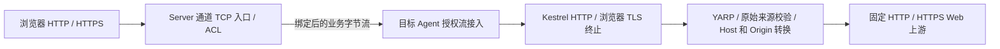
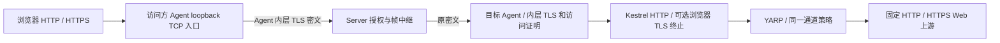

# HTTP/HTTPS 反向代理技术设计与 YARP 评估

文档 ID：DES-008\
状态：Draft\
版本：v1.5.0\
更新日期：2026-10-15\
调研日期：2026-10-12\
关联：[需求 REQ-001N](../requirements/2026-10-12-http-reverse-proxy.md)、[ADR-0026](../adr/0026-http-proxy-over-tcp-tunnels.md)

实现状态：协议 v5 的 HTTP/HTTPS 反向代理已经在主线运行，包括目标 Agent 的 Kestrel/YARP 虚拟入口、Host/Origin 策略、公网 TLS 透传和加密互访的内层 TLS。本文状态保持 Draft，因为第 2 节的方案比较、PoC 门槛和未在目标环境测量的容量结论仍是设计记录，不能把它们写成已验收事实。可执行步骤以 [HTTP 使用指南](../operations/http-reverse-proxy.md) 和 [验证记录](../testing/http-reverse-proxy-verification.md) 为准。

## 1. 结论与现状

按用户最新方向，HTTP 解析、入口 TLS 终止、Host/Origin 策略和 Web 上游连接统一放在目标 RelayLink.Agent。Server 继续负责通道配置、鉴权、授权映射、ACL、隧道配对、限额和审计，不解析 HTTP；访问方 Agent 保留本机 TCP 接入与加密互访，不引入 YARP。现有 raw TCP/UDP 逻辑保持。

推荐目标 Agent 使用专用 Kestrel + YARP IHttpForwarder，将已授权隧道流接入无 OS 监听端口的 Kestrel 虚拟传输。公网 HTTPS 由浏览器直接与目标 Agent 的入口证书握手；互访保留既有内层 TLS，之后才把浏览器字节交给该 HTTP 入口。已实现四种入口的真实 Server/Agent 接入，具体可重复证据见 [HTTP 验证](../testing/http-reverse-proxy-verification.md)。虚拟入口专项覆盖 TLS、WebSocket、流式、来源、限额和失败无重放；这些结果不代表生产容量或任意目标应用的浏览器兼容性。

当前 ControlSessionWorker 的普通路径连接目标 socket；PeerSessionCoordinator 的目标路径在内层 TLS/访问证明成功后连接目标并转发。HTTP 模式改为选择目标 Agent 内部 HTTP 入口，不直接连接 Web 上游。Server 当前协议支持 v3/v4/v5；v5 增加 HTTP 配置、可信上下文和就绪信息，旧端快照删除 HTTP 增量，继续按各自版本处理 raw。

## 2. YARP 与宿主评估

| 选项 | 评估 | 结论 |
|---|---|---|
| 目标 Agent Kestrel + IHttpForwarder | 两种访问共享策略；解密发生在目标端；固定目标不需集群路由 | 优先 |
| Server YARP | 无法在保留互访密文中继时统一改写 HTTP，入口私钥也会留 Server | 不采用 |
| 两侧 Agent 都使用 YARP | 重复策略、增加访问方负担及两次 HTTP 转换 | 不采用 |
| 目标 Agent 在 loopback 开普通 HTTP 代理端口 | 宿主简单，但本机进程可能绕过映射授权，且上下文易串线 | 不作为默认；仅作隔离 PoC 对照，不交付裸入口 |
| Kestrel 自定义连接监听器/虚拟 EndPoint | 直接接收授权 Stream/IDuplexPipe 与可信连接特征，无本机旁路端口 | 已实现并通过虚拟入口测试 |
| 自写 HTTP 解析或完整 YARP 集群管线 | 前者协议/安全成本高，后者重复 RelayLink 配置及路由 | 不采用 |

本轮采用并固定 Yarp.ReverseProxy 2.3.0；官方发布页说明支持 .NET 8 及以后并保留 MIT 许可，Agent 项目已引用该版本。[YARP 发布](https://github.com/dotnet/yarp/releases/tag/v2.3.0)

IHttpForwarder 可使用自有 HttpMessageInvoker、转换器，支持流式和 WebSocket；路由由固定通道决定，目标 Agent 的客户端只连接本机/内网 Web 上游，不再由 Server ConnectCallback 打开隧道。[直接转发](https://learn.microsoft.com/en-us/aspnet/core/fundamentals/servers/yarp/direct-forwarding?view=aspnetcore-10.0)

IConnectionListenerFactory 可绑定自定义 EndPoint；ConnectionContext 提供 IDuplexPipe Transport、Features、连接取消与释放接口。虚拟传输使用 ConnectionContext 的自行管理取消源，避免 DefaultConnectionContext 的异步 Abort 与 Dispose 竞争；Stream→Pipe、嵌套 TLS、关闭结果另见项目测试证据，不能仅凭 API 文档声称组合正确。[连接监听器](https://learn.microsoft.com/en-us/dotnet/api/microsoft.aspnetcore.connections.iconnectionlistenerfactory?view=aspnetcore-10.0)、[ConnectionContext](https://learn.microsoft.com/en-us/dotnet/api/microsoft.aspnetcore.connections.connectioncontext?view=aspnetcore-10.0)

## 3. 两条数据路径

### 3.1 公网访问

Server 独立端口绑定固定 clientId/channelId，执行来源 IP 安全组、在线/能力/readiness、连接与 pending 配额及审计检查；不凭 Host 选择目标，不终止浏览器 TLS。控制消息先确定 HTTP 模式、入口 scheme、策略版本与来源上下文，绑定令牌仍只用一次。

目标 Agent 确认通道 active 版本、资源可用及连接租约后报告 HttpIngressReady（type=24）；它只表示代理入口准备好，不表示 Web 上游可达。Server 审计成功后发 Start，Agent 将原始业务流交给 Kestrel。HTTPS 握手在目标 Agent 执行；HTTP 上游连接在请求校验后由 YARP 发起。不能继续把普通 TargetReady 的目标 socket 就绪语义用于 HTTP。

### 3.2 加密互访

按现有 PeerOpen→双侧 PeerBindData→内层 TLS→随机挑战/HMAC 访问证明执行；HTTP 必须 endToEndEncryptionEnabled=true。证明成功后由 PeerApplicationStream 解开内层 TLS 中既有的 4 字节长度应用记录，再把浏览器字节交给 HTTP 虚拟入口，不先直连 Web 目标。访问方只复制浏览器字节，不修改 Host/Origin、不解密浏览器 HTTPS。浏览器 HTTPS 时，内层 TLS 的业务内容仍是一条独立浏览器 TLS 流，目标 Agent 的 Kestrel 再终止这层 TLS。

现有互访目标成功标记表示目标 socket 就绪；HTTP v5 分支发送 byte=2 的入口就绪结果（raw 保留 byte=1），由目标确认宿主资源和连接额度后，在内层 TLS 中发送，访问方消费完整结果后才转发浏览器字节。不能等待浏览器 TLS 握手或首个 Web 请求完成才发送就绪，否则访问方仍在等结果、浏览器数据无法到达，会形成互等。公网 HttpIngressReady 同样必须先于 Start，后续浏览器 TLS 握手属于 active 连接的独立限时阶段。旧 raw 分支的成功标记及目标就绪语义保持。

访问证明上下文应域分隔并绑定 applicationProtocol、HTTP 策略摘要/版本、mappingId、入口 scheme 和已确认外部 authority，防止同一密钥下模式或入口混淆；访问方映射与目标快照都须匹配，不能仅在 Server 配对时检查。新增字段/消息必须按新版本定义，不静默改变旧证明计算。

保留 authorizedClientsOnly 的互斥访问边界：公开通道没有互访映射，授权通道没有 Server 业务监听；同一 Web 目标可由两个通道分别提供公网与互访，两者复用同一 Agent HTTP 引擎但配置、配额和池隔离。

## 4. 虚拟 HTTP 入口与连接身份

目标 Agent 使用独立业务宿主，不接入现有 Agent 状态页路由。建议按 serverProfileId/channelId/activePolicyVersion/入口 scheme 创建虚拟 EndPoint；每个已授权连接携带不可变连接上下文：connectionId、目标客户端、通道、配置版本、accessKind、入口 scheme，及公网 sourceIp 或互访 callerClientId/mappingId/已确认映射 authority。channelId 取自握手与快照，不取自 HTTP 路径或头。

以有界接入队列把授权 Stream 转为 ConnectionContext.Transport；队列上限为 min(通道连接上限, 32)；公网 Start/互访就绪标记之后执行非阻塞入队，队列满立即中断该流，就绪不承诺未来请求成功，满时拒绝，不阻塞并无限累积 Pending。Stream→Pipe 两方向均需取消、有限缓冲、背压、EOF 与 Abort 传播；不能把 Bind 帧、内层 TLS 挑战/证明或私有元数据前导字节交给 HTTP 解析器，也不能因预读丢失 ClientHello/首个 HTTP 字节。

公网流为 Start 后的原始业务流；互访流为访问证明及 byte=2 标记后，经 PeerApplicationStream 解帧的内层 SslStream 业务流。HTTPS 虚拟入口随后运行 Kestrel TLS；不按首包嗅探决定 http/https，不允许客户端自行切换入口 scheme。第一阶段入口与 Web 上游均为 HTTP/1.1，禁用 HTTP/2/3，避免初期多路复用改变资源与上下文模型。

每个请求（包括 keep-alive 后续请求）都从其 ConnectionContext 获取身份、活跃版本及真实外部入口信息，重新校验 Host/Origin，不能只校验首个请求；禁止从转发头推断是公网还是互访。虚拟宿主不创建对 LAN 或 loopback 开放的业务 socket，因此本机未知进程不能绕过接入门槛直接调用代理。

## 5. TLS 分段与证书部署

| 场景/段 | TLS 终止位置与保护范围 | 说明 |
|---|---|---|
| 公网 HTTPS：浏览器→Server→目标 Agent | 浏览器业务 TLS 在目标 Agent Kestrel 终止 | Server 中继密文；普通隧道业务载荷受浏览器 TLS 保护 |
| 公网 HTTP：浏览器→Server→目标 Agent | 无浏览器 TLS | 明文，敏感公网部署不采用；控制 TLS 不补足 |
| 互访 HTTP：访问方 Agent→Server→目标 Agent | 既有内层 TLS 在目标 Agent 终止 | 保留固定 Agent 身份、访问证明；loopback 浏览器段仍为 HTTP |
| 互访 HTTPS：浏览器→目标 Agent | 浏览器 TLS 嵌套于 Agent 内层 TLS，在目标 Agent Kestrel 终止 | 两层独立验证，不能关闭内层 TLS |
| 目标 Agent→HTTPS Web 上游 | Agent SocketsHttpHandler 建立并验证上游 TLS | 与入口证书及 Agent 互访身份独立 |
| 目标 Agent→HTTP Web 上游 | 无 TLS | 仅用于受信目标段，不能说互访 TLS 延伸到 Web 服务 |

Server 对 HTTPS 业务不解密，不代表所有部署内容都不可见：公网 HTTP 是明文，Server 仍知道来源/通道/连接元数据；普通数据 Bind 令牌也不受浏览器 TLS 覆盖，继续要求数据入口最小暴露与受保护网络。Agent 是 HTTP 信任端点并可见明文，不声称浏览器到 Web 服务只有一条端到端 TLS。上游 HTTPS 与 Host/SNI 行为依据 [YARP TLS 文档](https://learn.microsoft.com/en-us/aspnet/core/fundamentals/servers/yarp/https-tls?view=aspnetcore-10.0)。

公网域名证书私钥预置目标 Agent，Server 仅存 certificateRef，控制快照只含资源 ID，不分发私钥。证书资源按 serverProfileId 隔离，以固定资源目录和允许 ID 解析，禁止快照任意指定本机文件路径。Agent 本地只有证书/信任等部署材料，不维护通道业务配置；此类材料与现有 Agent 身份私钥一样是宿主资源。入口证书 PEM 的首张为叶证书，其后 CA 中间链单独导入并传给 Kestrel ServerCertificateChain，避免只读叶证书丢失中间链；材料有效期与 CA 类型在加载时校验，生命周期与宿主一致。既有 Agent 内层 TLS 自签身份不能自动用作浏览器受信 HTTPS 证书。续期通过部署工具完成、重启加载；不引入自动签发、全局根证书安装或忽略校验。

互访 HTTPS 的浏览器 URL 名称必须能解析到访问方 127.0.0.1，且目标 Agent 入口证书 SAN 覆盖该名称。例如 https://panel.peer.example.test:动态端口/，本机 DNS/hosts 由部署方显式配置；也可使用 SAN 含 localhost/IP 的受信内部 CA 证书。端口不进入 SAN，但必须进入 Host/Origin 允许规则。仅信任 Agent 互访证书指纹不能使浏览器自动信任入口证书；访问方系统须信任入口签发链，不自动修改系统信任或 hosts。

普通/互访入口 scheme 与上游 scheme 独立。物理 targetHost:targetPort 仍由目标 Agent 连接；逻辑 upstreamAuthority 定义 Web 虚拟主机与 TLS 名称。可在目标 Agent 使用 ConnectCallback 对固定物理地址建 socket，返回未包 TLS 的流，再让 SocketsHttpHandler 根据逻辑 URI 建 TLS，避免逻辑域名解析到错误目标。第一阶段 HTTPS 上游的有效 Host 必须与逻辑 authority 主机/有效端口一致；preserve/fixed 不满足时拒绝配置，不用跳过验证修复。分离 HTTP Host 与 TLS 名称的更复杂站点后续评审。

## 6. 原始 Host、Origin 与可信转发头

统一处理顺序：验证连接授权与 active 版本→取得原始入口 scheme/Host→校验原始 Host/Origin→删除来访转发头→转换 Host/Origin→连接固定 Web 上游。目标 Agent 必须先检查原始来源，不能在 fixed 后再校验。Server 无法在 HTTPS 建隧道前检查 Origin，因此非法来源会在目标 Agent 解析请求后返回 403，仍未连接 Web 上游。

| 策略 | 目标 Agent 行为 | 约束 |
|---|---|---|
| hostMode=upstream（默认） | 派生固定逻辑上游 Host | HTTPS 名称一致 |
| hostMode=preserve | 保留校验后的入口 Host | 公网/互访 allowedAuthorities 各自限制；HTTPS 名称一致 |
| hostMode=fixed | 替换为配置的 authority | 无路径/userinfo/CRLF/多值；HTTPS 名称一致 |
| originMode=preserve（默认） | 保留合法 Origin 或缺失 | 公网/互访允许列表必须非空；存在值须匹配。列表为空时普通请求仍放行，WebSocket 拒绝。WS 缺失拒绝 |
| originMode=fixed | 先匹配入口允许来源，再替换固定 Origin | 列表非空且无通配；普通缺失不补值，WS 缺失拒绝 |

Origin 规范化按 scheme、DNS host（大小写不敏感）、有效 port 精确匹配，无 path/query/fragment/userinfo；拒绝 null、多值/逗号列表、非法编码和 CRLF，不允许后缀模糊匹配。公网使用显式允许来源；互访允许来源可引用 entry，表示由已确认 mapping authority 与 peerEntryScheme 派生的唯一来源，不是通配任意 localhost 端口。映射端口变化时先确认新上下文，撤销旧连接与来源；访问方状态页展示可用 URL，不修改浏览器 Origin。

两种模式分别指定允许原始入口，但 host/origin 转换参数由目标通道统一决定。例：公网允许 https://panel.example.test，互访允许 http://127.0.0.1:已确认端口；两者通过后可统一转给上游 Host=127.0.0.1:18789、Origin=http://127.0.0.1:18789。未知网站握手应 403。Origin 可由非浏览器伪造，不能替代访问证明或 Web 登录。

删除所有来访 Forwarded/X-Forwarded-*，并始终删除客户端提供的 X-Real-IP、True-Client-IP、X-Client-IP、CF-Connecting-IP。stripRequestHeaders 追加更多精确头名称，清空该列表不会恢复上述内置项。之后由可信上下文及请求实际入口重建 X-Forwarded-Host/Proto。公网 X-Forwarded-For 使用经控制上下文绑定的 Server 所见来源 IP；互访不凭空生成浏览器公网 IP，不转发伪造 For，用结构化上下文/日志保留 callerClientId。上下文不是 HTTP 头，也不注入 PROXY protocol 到 Web 目标。Server 是既有受信协调者，其公网来源声明不是对恶意 Server 的独立证明；互访隐私也不升级为抵抗失陷控制平面的新安全承诺。

Referer 保留，不自动生成 CORS 响应或改 Location、Set-Cookie、CSP、HTML、绝对 URL。目标只信任明确的代理来源并保留身份验证；公开基址、Cookie、CSRF 和浏览器安全上下文仍需目标应用实测。[YARP 请求转换](https://learn.microsoft.com/en-us/aspnet/core/fundamentals/servers/yarp/transforms-request?view=aspnetcore-10.0)

## 7. WebSocket、上游池与资源生命周期

YARP 支持 HTTP/1.1 Upgrade 与双向流；入口 ws/wss 与上游 HTTP/HTTPS 组合分别测试，握手前检查原始 Host/Origin 和请求配额，升级后不改帧或 Sec-WebSocket-*。WebSocket 识别按 Upgrade 的逗号分隔协议标记进行，大小写不敏感并去掉首尾空白，因此 websocket, foo 与重复 Upgrade 值同样进入 Origin 校验和 WebSocket 活动超时。空的来源允许列表对 WebSocket 一律拒绝，包括与入口相同的 Origin。HttpMessageInvoker 避免全量响应缓冲，使用 UseProxy=false、UseCookies=false、AllowAutoRedirect=false、AutomaticDecompression=None，不跟随跳转或接受任意目标。[WebSocket 文档](https://learn.microsoft.com/en-us/aspnet/core/fundamentals/servers/yarp/websockets?view=aspnetcore-10.0)

每个前端业务 TCP 连接仍对应一个普通隧道或互访会话，可承载多个顺序 HTTP 请求；上游连接池现在位于目标 Agent，不等于隧道池。池按 serverProfileId/channelId/activePolicyVersion、上游逻辑 authority 与信任策略隔离；各请求携带自己的上下文，不把创建上游连接者身份复用于后续来源。WebSocket 升级的上游连接独占，关闭不回池。

Server/两侧 Agent 保留隧道/pending 配额及原审计门槛；目标 Agent 另设 HTTP 并发、上游连接池和接入队列额度，池空闲也占上游连接预算。实际默认值：头总量 32 KiB、体积 30 MiB、头读取及浏览器 TLS 握手各 15 秒、上游连接寿命 0（不跨请求复用），空闲设置 60 秒仅保留客户端默认约束、普通流式活动空闲 120 秒、WebSocket 活动空闲 300 秒；HTTP 请求与上游连接并发不超过通道上限。maxWebSocketConnections 为 0 时 WebSocket 并发上限等于通道 maxConnections，配置为正数时单独收紧且不得超过通道上限，避免长连接占满后普通请求持续 503。HTTP/1.1 每请求占用一条已受 Agent 全局连接/pending 额度控制的授权流，WebSocket 长连接持续占用租约。上述为实际默认值，不是容量证据。

隧道建立沿用 openTimeoutSeconds；互访内层 TLS/证明和目标入口 TLS 分阶段限时，不能让其串联绕过总 pending 期限。流式写阻塞期限、有界缓冲、取消、Pipe 完成与 TLS close/EOF 传播需要单独验证；不把旧 socket Shutdown(Send) 直接套到虚拟 Pipe 或嵌套 SslStream。SSE/WS 不施加短总请求超时。普通流式活动空闲 120 秒；WebSocket 活动空闲默认 300 秒，范围 0–86400。0 只表示互访通道上的显式无限空闲，公网入口校验拒绝 0；若公网运行时仍见到 0，按 300 秒处理，避免空闲 WebSocket 一直占用连接配额。长连接仍受外层控制会话存活及撤销约束。[YARP 超时](https://learn.microsoft.com/en-us/aspnet/core/fundamentals/servers/yarp/timeouts?view=aspnetcore-10.0)

请求取消释放请求额度；隧道、内层 TLS、虚拟连接和上游所有权分别明确，统一由租约执行一次结束。掉线、撤销、active 版本变化、停止清空受影响虚拟队列、连接及上游池，不恢复旧会话。YARP 不提供重试不代表底层连接池没有内部重试；目标侧请求计数及发送中断必须证明已发送请求没有重放，第一阶段使用 HTTP/1.1 exact 且 PooledConnectionLifetime=TimeSpan.Zero，避免失效复用连接的内部重试路径；上游收到 GET/POST 后主动中断，测试确认各只有一次送达。代价是每次普通请求新建上游 TCP/TLS；后续恢复复用须单独评审无重放证据。[连接寿命](https://learn.microsoft.com/en-us/dotnet/api/system.net.http.socketshttphandler.pooledconnectionlifetime?view=net-10.0)

## 8. 集中配置、能力与激活

配置模型、校验、v5 协议及 HTTP 运行时接入均已实现。脱敏示例为 [http-client.example.json](../../config/examples/http-client.example.json)，HTTP 通道默认禁用；不能据配置校验成功声称转发可用。下表名称在实现中以 HttpProxyOptions 为准：hostMode/hostValue、originMode/originValue 为 http 下的平铺字段；限额同样平铺，不使用未实现的 host/origin/limits 子对象。

| 字段 | 实际含义 |
|---|---|
| channel.applicationProtocol | raw（缺省）/http，HTTP 必须 transportProtocol=tcp |
| channel.http.publicEntryScheme / peerEntryScheme | 分别 http/https，仅所选访问模式生效 |
| channel.http.publicAllowedAuthorities / publicAllowedOrigins | 公网精确允许入口 authority/Origin；公网通道的 Origin 列表必须非空 |
| channel.http.peerAuthorityHost / peerAllowedOrigins | 解析到 IPv4 loopback 的本机 DNS 名称或 127.0.0.1；允许 entry 派生已确认映射 scheme/host/port；列表必须非空 |
| channel.http.certificateRef / upstreamTrustRef | 目标 Agent 受限部署资源 ID；仅引用，不下发私钥/CA 私密材料 |
| channel.http.upstreamScheme / upstreamAuthority | 固定 Web 上游 scheme 与逻辑 authority；物理地址沿用 targetHost/targetPort |
| channel.http.hostMode / hostValue、originMode / originValue | 两种入口共享的转换规则 |
| channel.http.maxRequestBodyBytes / maxRequestHeaderBytes / headerTimeoutSeconds / activityTimeoutSeconds / webSocketActivityTimeoutSeconds | 字节与秒，体积 1–1 GiB、头 1–64 KiB、头超时 1–300 秒、普通活动 1–3600 秒、WS 默认 300 秒、范围 0–86400；公网 WS 禁止 0 |
| channel.http.maxWebSocketConnections | 0 表示沿用通道连接上限；正数单独限制并发 WebSocket，且不得超过该上限 |
| channel.http.stripRequestHeaders | 在内置 Forwarded、X-Forwarded-* 与四项客户端 IP 头之外再删除的精确头名称，最多 32 个 |
| mapping 派生字段 | 应用模式、peer scheme、URL host、实际绑定端口、策略版本；不重复手工维护目标策略 |

目标 Agent 快照包含完整 HTTP 策略/资源引用；访问方只得到授权映射、模式、peer scheme/authority、版本与已有密钥/目标身份，不接收 Web 上游凭据或入口私钥。凭据仍由目标应用认证，不增加通用静态 Authorization 注入。控制连接对 HTTP 两种模式都要求 TLS，保护策略与身份下发。

协议 v5 显式加入 HTTP 能力、快照表示、Open/PeerOpen 的 httpIngress 上下文与 readiness；一次性数据绑定版本必须匹配会话。目标收到 HTTP mode 绝不走旧 socket 直连分支，客户端能力不可由 AgentVersion 文本推断。快照摘要和互访证明加入 HTTP 模式与策略版本域；旧版本序列化删除新增字段及不支持的通道/映射，保留其旧摘要形状，遵循 [ADR-0025](../adr/0025-v3-client-compatibility.md)。

| Server/Agent 组合 | raw TCP/UDP | HTTP |
|---|---|---|
| 新 Server + 旧 v3/v4 Agent | 按既有版本矩阵继续支持 | 不下发 HTTP 通道/映射，管理状态显示能力不足，无静默 raw 降级 |
| 新 Server + 新目标 Agent | 继续原能力 | 普通入口可用，需匹配策略/readiness/资源 |
| 新 Server + 新访问方和目标 Agent | 继续原能力 | 加密互访可用，双方模式/版本匹配 |
| 互访任一 Agent 无 HTTP 能力 | 既有 raw 不受影响 | 拒绝 HTTP 映射，不回退明文或普通入口 |
| 旧 Server + 新 Agent | 不在本轮承诺自动版本降级 | 明确不支持；升级顺序先 Server 后相关 Agent |

通道策略只由 Server 管理；Agent 重连取得 desired 快照，但 HTTP 宿主在该 profile 的 Worker 创建后首次快照激活其策略与资源，不做热加载。运行中收到新的 HTTP 策略、通道禁用或移除时，先把该宿主移出表，再停止其 WebApplication 并释放 HttpMessageInvoker 与证书，然后置 restart_required。宿主表的准备与接入加锁；对已释放宿主的后续接入成为协议错误或 I/O 失败，不把 ObjectDisposedException 留成未处理故障。以 HttpStatus（type=23）报告 desired policyHash 及 ready/resource_unavailable/restart_required；ready 表示该 hash 已激活，其他状态没有对应 active 宿主。ConfigAck 只表示收到，不能等同 HTTP 就绪。重启目标 Agent 后报告每通道状态与 hash，Server 验证后放行。互访入口 scheme/名称/策略变更需要访问方重启激活映射；端口冲突轮换仍沿用既有机制，但新端口与 entry 上下文确认前不接入 HTTP。Agent 本机页面既有停用/启用或导入替换会重建该 profile 的 Worker，也可完成显式激活；普通控制重连不重建 HTTP 宿主，不新增热更新。其他 raw 通道按既有方式工作。

资源缺失只拒绝受影响 HTTP 通道并报告具体类别，不自动换证书或关闭 TLS。HTTP 禁止 UDP、禁止互访加密关闭；不把 EndToEndEncryptionEnabled 当普通公网隧道 TLS。新增配置以 file validation→备份→重启→readiness 验证生效，部署与验证见 [HTTP 运维说明](../operations/http-reverse-proxy.md)，现有页面仅扩充只读模式/状态/URL，不增加 HTTP 策略写入接口。

## 9. 故障、流量与日志

Server 不生成 HTTP 错误：Agent 离线、能力/readiness 不足、建立失败或 ACL 拒绝在 TLS/HTTP 处理前直接断开；不得把明文 503 写入 HTTPS 字节流。目标 Agent 的 Kestrel/YARP 建议返回非法头 400、Host 不允许 421、来源拒绝 403、请求体越界 413、请求配额满 503、Web 上游连接/TLS 失败 502、上游超时 504；响应开始或升级后只能中断流。入口证书或 TLS 握手失败按 TLS 错误关闭。

Server 沿用普通隧道/互访帧载荷字节计数：公网 HTTPS 含浏览器 TLS 开销，互访 HTTPS 包含两层 TLS；不等同 Web 正文大小。目标 Agent 每请求记录状态码、耗时、取消、通道、tunnel connectionId、callerClientId/mappingId；不增加未实现的 Server HTTP 聚合计数；多个请求共享隧道时不混淆请求来源。HTTP 详细状态先在 Agent 脱敏日志/只读状态提供，Server 不为聚合而要求解密或接收正文。

关闭默认完整 URL/查询和头日志；不记录 Authorization、Cookie、密钥、证书私钥、正文或 WS 内容。新模式在两端只读视图明确标识 http/https、实际可用 URL、加密、能力和 desired/active/readiness，不能只显示 TCP 在线就声称 HTTP 可用。

## 10. 验证门槛与未覆盖范围

本轮未写代码，以下全部待执行：

1. 真实普通/互访授权 Stream→自定义 Kestrel Transport，保证无本机旁路、前导/预读字节错误、跨通道/profile 上下文串线；多请求、队列满、取消、EOF/半关闭、停止释放。
2. 公网 HTTP/HTTPS 与互访 HTTP/HTTPS 四组合；捕获 Server 中继的 HTTPS/互访业务密文，证明 TLS 终止在目标 Agent、互访不能降级；公网来源及 mapping 上下文抗替换。
3. 浏览器入口证书、loopback 名称解析、动态端口/entry 派生；内层 Agent 身份、浏览器入口和 Web 上游信任三者独立。SNI/Host/逻辑 URI 正确，错名/过期/未知 CA 拒绝。
4. 两种入口 Host/Origin/转发头负例、ws/wss 子协议、关闭、嵌套 TLS、SSE、慢读写、上传与请求重放计数；实际 Web 应用 CSRF、登录、跳转、Cookie 与安全上下文。
5. 新旧 Agent 版本矩阵、快照摘要、HTTP 域分隔访问证明、策略 restart_required/HttpReady 及端口轮换；审计失败、配额满、掉线、池过期和故障清理。
6. Windows/Linux Server 与 Windows/Linux/macOS（Intel/Apple Silicon）两侧 Agent；评估目标 Agent 引入 Kestrel/YARP 后的发布体积、ASP.NET Core 运行时依赖与内存预算，不把官方 API 支持当本仓库平台通过。

核心实现与当前本机证据见 [验证记录](../testing/http-reverse-proxy-verification.md)，部署方案见 [运维说明](../operations/http-reverse-proxy.md)。真实业务 Web 登录/CSRF/跳转/Cookie、长期容量及实际生产网络抓包仍需要目标环境验证，不以本机 echo 或跨平台 CI 替代。需求中 A85–A91 的证据覆盖与缺口分别记录，不自动将需求标为 Done。
