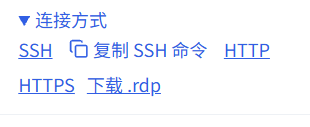

# 移除 Agent 本机页的「连接方式」菜单

文档 ID：REQ-001Q\
状态：Draft\
版本：v0.1.0\
更新日期：2026-11-28

## 用户需求

用户试用后认为这组快捷操作未达到预期，要求移除 Agent 本机页「本机互访入口」表格中普通 TCP 入口的「连接方式」菜单。原有交互见 [ADR-0042](../adr/0042-agent-native-tool-links.md)。

## FR-AGENTWEB-01 移除普通 TCP 入口的快捷操作

移除「连接方式」展开控件及其中的 SSH、复制 SSH 命令、HTTP、HTTPS 和 Windows 上的「下载 .rdp」五项操作。普通 TCP 和单播 UDP 入口继续显示并可复制本机地址。已就绪的 HTTP/HTTPS 反向代理入口继续显示可直接打开和复制的完整 URL。

## 验收标准

| 编号 | 操作 | 预期结果 |
|---|---|---|
| A120 | 分别在 Windows 和其他支持的平台查看已有本机地址的普通 TCP 互访入口，并用键盘遍历该行 | 行内显示本机地址和地址复制按钮。「连接方式」展开控件及菜单内的快捷操作均已移除，键盘焦点也不会停在这些控件上 |
| A121 | 分别复制普通 TCP 和单播 UDP 入口的本机地址 | 剪贴板内容与该行实际绑定的主机和端口一致 |
| A122 | 分别查看已就绪的 HTTP 和 HTTPS 反向代理入口，打开并复制地址 | 页面链接和剪贴板均使用该入口配置的完整 URL |

实施时同步更新[项目说明](../../README.md)和[安装与使用指南中的本机入口操作](../operations/installation-and-usage.md#71-从-agent-本机页连接互访入口)。
